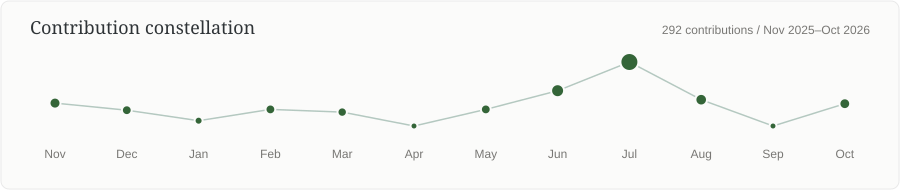
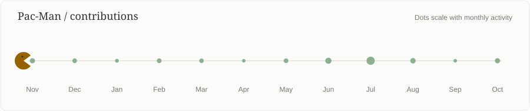

# Dhruv Verma

I build backend systems, computer vision tools, and useful interfaces. I study Electrical and Electronics Engineering at ABV-IIITM Gwalior and work as a backend SDE intern at Curefit.

[Email](mailto:dhruv83170@gmail.com) · [LinkedIn](https://www.linkedin.com/in/dhruv-verma-34a927282/) · [Portfolio code](https://github.com/dhruvv1101/portfolio) · [Coding profiles](#problem-solving)

## Selected work

**[ChessFlow](https://github.com/dhruvv1101/ChessFlow)** · Python, OpenCV, MediaPipe, Stockfish

A local chess assistant that turns webcam gestures into desktop controls, captures a `chess.com` board, extracts its position, and shows engine analysis in Streamlit. Its hosted mode displays the UI without attempting desktop automation.

**IntentLens** · Python, SQLite, Streamlit, Tkinter

A browser productivity project that records why a tab was opened, asks for reflection when it closes, and helps review browsing habits. Source is not public yet.

**[Portfolio](https://github.com/dhruvv1101/portfolio)** · React, TypeScript, Vite

An editorial personal site with project stories, interactive sections, and custom canvas scenes.

**[Student Health Risk on Kaggle](https://www.kaggle.com/competitions/playground-series-s6e7)** · CatBoost, LightGBM, feature engineering

My Playground Series S6E7 experiment uses engineered features and model blending for the competition's balanced accuracy metric.

## Elsewhere

- **Curefit · Backend SDE intern, May 2026–present.** Integrated Formbricks feedback into two order flows; proposed an idempotency design for asynchronous processing and am designing shipment invoice integration.
- **GirlScript Summer of Code · Mentor, 2025.** Worked on AI projects including [Karbon](https://github.com/dhruvv1101/Karbon) and [DataSentience-AIML](https://github.com/dhruvv1101/DataSentience-AIML).
- **HAL Korwa · Vocational intern.** Studied avionics workflows and hardware data flow in the Jaguar department.

## Problem solving

[LeetCode](https://leetcode.com/u/ImpWevvB/) · [Codeforces](https://codeforces.com/profile/Dhruv83170) · [CodeChef](https://www.codechef.com/users/msl_overflow) · [Codolio](https://codolio.com/profile/Dhruv83170)

## Contributions

Watch Pac-Man cross my monthly activity map

Both graphics are generated from GitHub contribution data by [this workflow](.github/workflows/contributions.yml).
