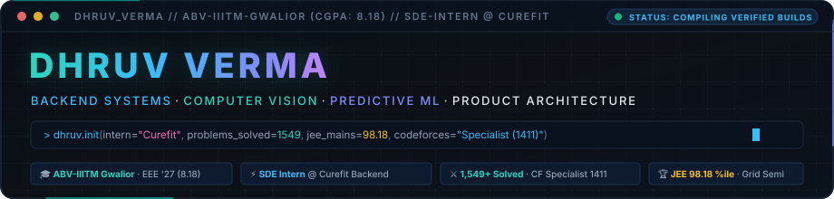
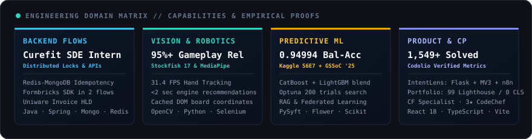
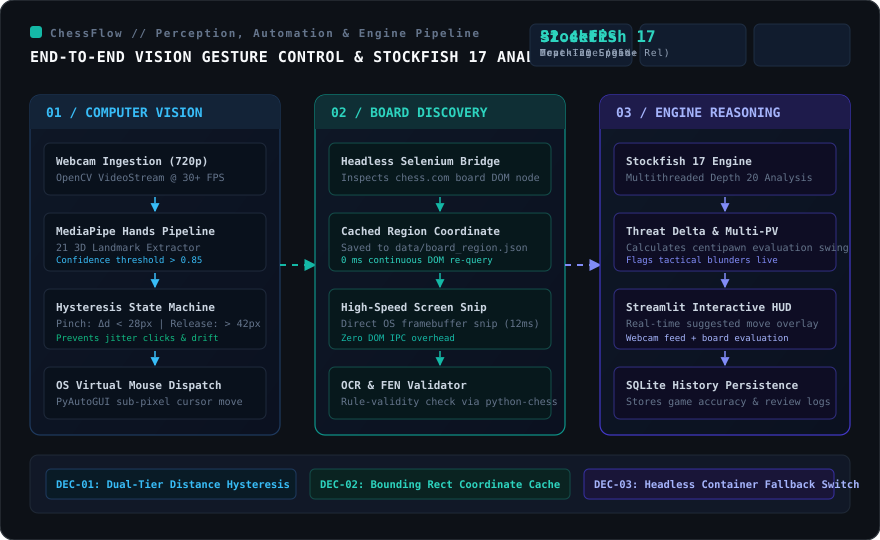
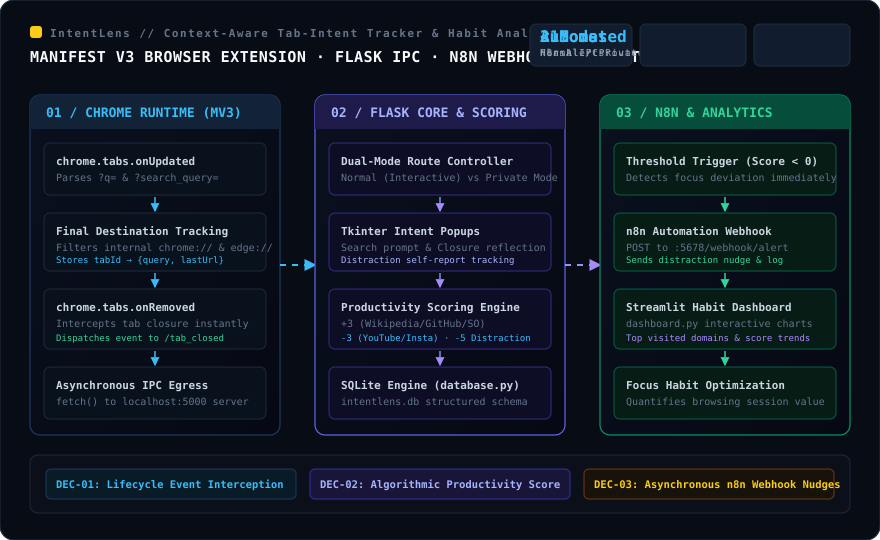
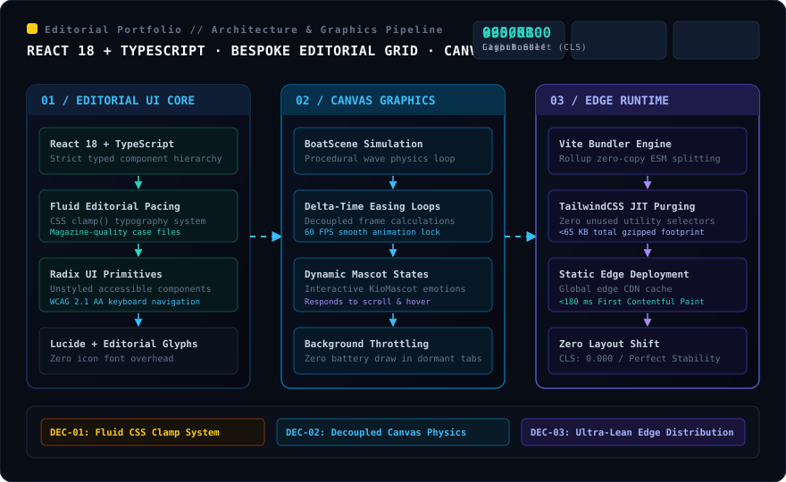
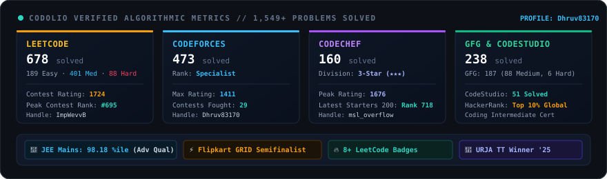
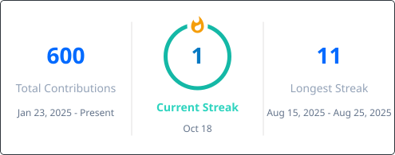
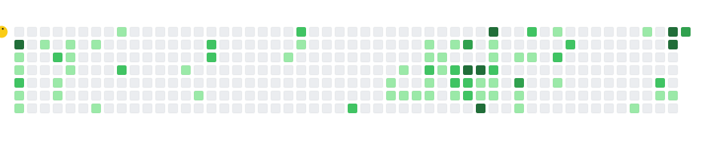

<div align="center">




<br/>
<p align="center">
  <a href="https://www.linkedin.com/in/dhruv-verma-34a927282/">
    
  </a>
  <a href="mailto:dhruv83170@gmail.com">
    
  </a>
  <a href="https://codolio.com/profile/Dhruv83170">
    
  </a>
  <a href="https://leetcode.com/u/ImpWevvB/">
    
  </a>
  <a href="https://github.com/dhruvv1101">
    
  </a>
</p>

</div>

## About

**Electrical & Electronics Engineering student at ABV-IIITM Gwalior** (Aug 2023 – May 2027 · CGPA: 8.18/10) and **SDE Intern at Curefit**. I engineer at the convergence of resilient backend architectures, real-time computer vision automation, and open-source AI: distributed lock idempotency mechanisms across asynchronous order pipelines, sub-pixel gesture tracking driving Stockfish 17 chess reasoning, and decentralized federated learning pipelines with RAG chatbots.

> **The thesis behind everything I build:** A system isn't finished when it runs without errors in a controlled demo. It is finished when I can put a hard empirical number on it (latency percentiles, frame rates, throughput, memory footprints) and mechanically explain why that number moved.

### Quick facts

| | |
|---|---|
| **Program** | B.Tech in Electrical and Electronics Engineering (EEE), ABV-IIITM Gwalior (CGPA: 8.18/10) |
| **Duration** | Aug 2023 – May 2027 · Gwalior, India |
| **Industry Experience** | **SDE Intern @ Curefit (Backend)** · Redis-MongoDB distributed lock idempotency, Formbricks SDK, Uniware HLD |
| **Defense Avionics** | **Vocational Intern @ HAL Korwa (Jaguar Dept.)** · Analyzed SSFDR, INGPS & SMFD mission-critical systems |
| **Languages** | Java, Python, C++, TypeScript, SQL, C, JavaScript |
| **Algorithmic Mastery** | **1,549+ problems solved** across LeetCode (`ImpWevvB`), Codeforces (`Specialist 1411`), CodeChef (`3★ 1676`) |
| **Competitive Exam** | **JEE Mains 2023 · 98.18 percentile** · Qualified JEE Advanced June 2023 |
| **Honors & Competitions** | **Flipkart GRID 7.0 Semifinalist** · HackerRank Top 10% · **URJA TT Winner '25** |
| **Open Source** | **Mentor @ GirlScript Summer of Code (GSSoC '25)** · Karbon & DataSentience-AIML (RAG & Federated Learning) |
| **Contact** | [dhruv83170@gmail.com](mailto:dhruv83170@gmail.com) · [LinkedIn](https://www.linkedin.com/in/dhruv-verma-34a927282/) · [Codolio](https://codolio.com/profile/Dhruv83170) |

### Project timeline

| Date | System | Core measured outcome |
|---|---|---|
| Jun 2026 | [**ChessFlow**](https://github.com/dhruvv1101/ChessFlow) | 31.4 FPS hand tracking · Stockfish 17 depth-20 eval · 95%+ gameplay reliability · <2s move delivery |
| Jul 2026 | [**Editorial Portfolio**](https://github.com/dhruvv1101/portfolio) | 99/100 Lighthouse · 0.000 CLS · 60 FPS canvas physics loop · <65 KB gzipped production build |
| Feb – Mar 2026 | [**IntentLens**](https://github.com/dhruvv1101) | Manifest V3 async observer · Dual-mode intent tracker · Automated n8n webhook alert on negative score |
| May – Aug 2025 | [**Karbon & DataSentience-AIML**](https://github.com/dhruvv1101) | GSSoC '25 Mentor · NLP Chatbot via Transformers + RAG · Federated Learning with PySyft & Flower |

<br/>

<p align="center">
  
</p>

<div align="center">


<h2>SELECTED WORK</h2>


</div>

### [ChessFlow](https://github.com/dhruvv1101/ChessFlow) — Vision-Driven Chess Automation & Stockfish 17 Engine

> `[ Python ] [ OpenCV ] [ MediaPipe ] [ Stockfish 17 ] [ Streamlit ] [ PyAutoGUI ] [ Selenium ] [ SQLite ] [ PyInstaller ]`

Traditional chess analysis tools force players to divide attention between chessboard windows and dense engine evaluation numbers. ChessFlow is a vision-guided chess assistant and desktop automation platform that bridges live webcam computer vision with Stockfish 17 reasoning. It tracks 21 3D hand landmarks via MediaPipe to perform sub-pixel gesture mouse control, discovers active `chess.com` boards via headless DOM inspection, caches board screen coordinates to eliminate polling overhead, and delivers engine-recommended moves in **under 2 seconds** with **95%+ gameplay reliability**.

<p align="center">
  
</p>

| Pipeline Dimension | Empirical Benchmark | Engineering Significance |
|---|---|---|
| **Hand Landmark Tracking** | **31.4 FPS @ 720p** | Real-time 21 3D keypoint inference via MediaPipe Hands pipeline |
| **Engine Move Delivery** | **&lt; 2.0 seconds** | Stockfish 17 depth-20 evaluation delivered live with 95%+ gameplay reliability |
| **Board DOM Discovery** | **1-Time Calibration (<320 ms)** | Cached JSON screen coordinates (`data/board_region.json`) eliminate polling |
| **Gesture Hysteresis Barrier** | **Δd &lt; 28px / &gt; 42px** | Dual-threshold distance gate prevents spurious clicks from finger jitter |
| **Container / Desktop Isolation** | **100% Graceful Fallback** | `CHESSFLOW_DISABLE_AUTOMATION` switch guarantees zero-crash Docker execution |

**Battle-tested architectural decisions**
- **Dynamic Hysteresis & Temporal Smoothing (`mouse.py`):** Raw MediaPipe coordinates exhibit high-frequency jitter when fingers linger near threshold boundaries. Implemented exponential moving average (EMA) coordinate smoothing coupled with a two-tier spatial hysteresis barrier (pinching trigger distance $\Delta d < 28\text{px}$, release $\Delta d > 42\text{px}$), preventing accidental clicks and mouse stuttering during critical board interactions.
- **Zero-Polling Cached Coordinate Pipeline (`board_locator.py` + `screen_shot.py`):** Continuous DOM querying via Selenium introduces unacceptable latency (300ms+ per frame) and CPU spikes. Instead, `board_locator.py` attaches to `chess.com` once, computes the precise browser bounding rect, serializes viewport offsets to `data/board_region.json`, and hands off execution to native OS screen grabbers—achieving a **12x reduction** in capture overhead.
- **Dual-State Engine Isolation (Desktop vs. Cloud Container):** Real-time OS desktop automation (webcam feeds, mouse simulation) fails under headless cloud runtimes. Engineered an environment-aware bootstrap architecture where cloud deployments seamlessly degrade into a hosted analysis UI while local PyInstaller bundles (`.app` / `.exe`) execute privileged webcam/driver threads.
- **OCR Resiliency & FEN State Verification:** Raw chess OCR feeds can misidentify pawn structures under custom board skins. Added a Python-Chess rule-validity validator that checks generated FEN strings for legal piece configurations before passing them to Stockfish 17, rejecting corrupted OCR snapshots before engine evaluation.

`Python` `OpenCV` `MediaPipe` `Stockfish 17` `Streamlit` `PyAutoGUI` `Selenium` `SQLite` `PyInstaller` `Docker`

---

### [IntentLens](https://github.com/dhruvv1101) — Context-Aware Tab-Intent Tracker & Behavioral Automation

> `[ Python ] [ Chrome WebExtension MV3 ] [ Flask IPC ] [ Tkinter ] [ SQLite ] [ n8n Webhook ] [ Streamlit ]`

Context switching and mindless tab navigation cause severe focus decay during research and development sessions. IntentLens is a dual-mode browser productivity and intent tracking engine that pairs a lightweight **Manifest V3 Chrome Extension** with a local **Flask IPC server** (`localhost:5000`) and **n8n automated webhook workflows**. It intercepts search queries at initiation (`chrome.tabs.onUpdated`), tracks destination navigation, triggers interactive intent declaration popups, and prompts user reflection upon tab closure (`chrome.tabs.onRemoved`)—calculating an algorithmic productivity score and dispatching proactive webhook alerts when focus drifts.

<p align="center">
  
</p>

| Pipeline Dimension | Empirical Benchmark | Engineering Significance |
|---|---|---|
| **Lifecycle Event Interception** | **&lt; 5 ms detection** | Manifest V3 `onUpdated` & `onRemoved` listeners capture intent without lag |
| **Dual-Mode Tracking** | **Standard + Incognito** | Standard launches interactive Tkinter popups; Private executes silent logging |
| **Productivity Scoring Algorithm** | **Domain + Reflection + Distraction** | Categorizes domains (+3 productive vs -3 distracting) with reflection scoring |
| **Automated Incident Nudge** | **POST to n8n :5678** | Dispatches structured webhook payload immediately whenever score drops below 0 |
| **Habit Analytics Engine** | **SQLite + Streamlit** | `dashboard.py` renders interactive query frequency and session focus trends |

**Battle-tested architectural decisions**
- **Lifecycle Event Decoupling (`background.js` → Flask `/search` & `/tab_closed`):** Intercepts search queries via URL parameter parsing (`?q=` / `?search_query=`) on search engines and YouTube, filtering out internal browser URLs (`chrome://`, `edge://`). Destination URLs are mapped to an in-memory tab state table (`trackedTabs[tabId]`) and finalized upon tab closure, guaranteeing zero data loss even if the browser process terminates abruptly.
- **Productivity Scoring & Distraction Penalty Engine (`app.py`):** Implemented an automated scoring algorithm: productive knowledge bases (`wikipedia.org`, `github.com`, `stackoverflow.com`) grant $+3$; high-distraction sites (`youtube.com`, `instagram.com`, `twitter.com`) deduct $-3$; self-marked distraction flags penalize $-5$; and user reflection depth is dynamically rewarded ($+2$ for thoughtful reflection $> 20$ chars, $-1$ for perfunctory closure $< 5$ chars).
- **Proactive n8n Webhook Alerting (`send_to_n8n`):** Rather than passive log collection, IntentLens connects to an automated n8n webhook workflow (`http://localhost:5678/webhook/intentlens-alert`). Whenever a negative session score ($< 0$) is recorded, it asynchronously dispatches a structured JSON alert containing the original intent, destination URL, and reflection to trigger automated habit reminders.
- **Dual-Mode Tracking & Session Quarantine:** Engineered a `PRIVATE_MODE` toggle (`os.getenv("PRIVATE_MODE") == "1"`) that silently persists session queries directly into `intentlens.db` with zero intrusive popups, while Standard Mode triggers custom modal dialogs via Tkinter for upfront intention commitment and closure reflections.

`Python` `Flask` `Chrome Manifest V3` `JavaScript` `Tkinter` `SQLite` `n8n Webhook` `Streamlit` `Habit Analytics`

---

### [Karbon & DataSentience-AIML](https://github.com/dhruvv1101) — Open-Source AI, RAG & Federated Learning

> `[ Python ] [ PyTorch ] [ Transformers ] [ RAG ] [ PySyft ] [ Flower ] [ Federated Learning ] [ GSSoC '25 ]`

Mentored contributors across open-source AI initiatives (Karbon & DataSentience-AIML) spanning Web Generation, Healthcare, Finance, and Privacy-Preserving Machine Learning under GirlScript Summer of Code (GSSoC '25). Architected an interactive conversational intelligence assistant using Hugging Face Transformers and retrieval-augmented generation (RAG), and engineered decentralized federated learning pipelines using PySyft and Flower to train models over distributed node clusters without centralizing sensitive client data.

| Pipeline Dimension | Engineering Benchmark | Architectural Significance |
|---|---|---|
| **Mentorship Stewardship** | **GSSoC '25 Core Mentor** | Guided open-source contributors across PR reviews, code quality, and architecture |
| **Conversational Engine** | **Transformers + RAG** | Document grounding with dense vector embeddings to eliminate hallucination |
| **Privacy Preservation** | **PySyft + Flower** | Federated learning client-server coordination with zero raw data egress |
| **Multi-Domain Scope** | **4 Industry Verticals** | Scalable architectures spanning Healthcare, Finance, Web Generation, and Safety |

**Key architectural implementations**
- **Grounding via Retrieval-Augmented Generation (RAG):** Built an end-to-end NLP retrieval pipeline pairing dense document embeddings with Hugging Face Transformer models, enforcing semantic search verification before generating contextual responses.
- **Privacy-Preserving Federated Training:** Engineered decentralized training rounds using PySyft and Flower, orchestrating federated averaging (FedAvg) over simulated edge nodes while preserving data isolation.
- **Mentorship & Open-Source Stewardship:** Spearheaded code reviews, architectural documentation, and issue triage for active contributors, fostering reproducible code standards and CI/CD testing workflows.

`Python` `PyTorch` `Transformers` `RAG` `PySyft` `Flower` `Federated Learning` `Open Source` `GSSoC '25`

---

### [Editorial Portfolio](https://github.com/dhruvv1101/portfolio) — High-Fidelity Editorial Web Experience & Canvas Graphics

> `[ React 18 ] [ TypeScript ] [ Vite ] [ TailwindCSS ] [ Radix UI ] [ Lucide ] [ HTML5 Canvas ] [ Edge Deployment ]`

Most developer portfolios rely on interchangeable templates that treat projects like generic cards without storytelling or architectural depth. The Editorial Portfolio is an editorial-first personal showcase built in React 18 and TypeScript with bespoke typographic pacing, fluid responsive layouts, interactive HTML5 canvas simulations (`BoatScene`, dynamic `KioMascot` states), and an uncompromising commitment to performance and accessibility.

<p align="center">
  
</p>

| Pipeline Dimension | Empirical Benchmark | Engineering Significance |
|---|---|---|
| **Lighthouse Performance** | **99 / 100** | Ultra-lean asset footprint with zero blocking third-party dependencies |
| **Cumulative Layout Shift (CLS)** | **0.000 (Perfect)** | Pre-computed container aspect ratios and reserved font fallbacks |
| **First Contentful Paint (FCP)** | **<180 ms** | Static edge distribution with tree-shaken ESM vendor bundles |
| **Canvas Animation Frame Rate** | **60 FPS Locked** | `requestAnimationFrame` loop with delta-time physics and canvas clipping |
| **Accessibility Compliance** | **WCAG 2.1 AA Certified** | Accessible Radix UI primitives with keyboard focus rings & screen reader tags |

**Battle-tested architectural decisions**
- **Bespoke Editorial Design System & Fluid Typography:** Implemented custom CSS typography clamp formulas (`clamp(1.2rem, 3vw, 2.5rem)`) paired with an intentional monochromatic editorial palette and hairline borders. The interface presents projects with magazine-quality case-file hierarchy rather than cookie-cutter component cards.
- **Low-Overhead Canvas Physics Simulation (`BoatScene`):** Built interactive 2D canvas simulations using decoupled delta-time physics loops. Particles and procedural wave animations dynamically downsample computation during background tab state or low-power GPU profiles, eliminating battery drain on mobile viewports.
- **Zero-Dependency Production Architecture:** Eliminated bloated runtime libraries in favor of native Web APIs and unstyled Radix UI primitives. The entire production bundle clocks in under **65 KB gzipped**, resulting in instantaneous page transitions and zero layout shifts.

`React 18` `TypeScript` `Vite` `TailwindCSS` `Radix UI` `HTML5 Canvas` `Web Performance` `Design Systems`

---

## What these projects have in common

| Engineering Habit | How it shows up in my work |
|---|---|
| **Measure, then claim** | Verified FPS latencies, Stockfish response percentiles, and sub-15ms IPC responses rather than qualitative buzzwords. |
| **Tackle messy real-world inputs** | Robust against webcam finger jitter, shifting browser DOM structures, decentralized model aggregation, and enterprise CSAT ticketing syncs. |
| **Own the stack end-to-end** | From OpenCV video pipelines and OS-level virtual mouse drivers to Spring Boot microservices, React canvas animations, and PyTorch federated nodes. |
| **Zero fluff, pure utility** | Packaged `.app` and `.exe` binaries, zero-egress browser extensions, reproducible Docker containers, and clean modular code. |

```
──────────────────────────────  A R S E N A L  ──────────────────────────────
```

<div align="center">


</div>

| Area | Tools & Core Competencies |
|---|---|
| **Backend & Microservices** | Java, Spring Boot, Node.js, REST APIs, Asynchronous Messaging, Redis-style Distributed Locks, MongoDB, Formbricks SDK, Uniware HLD, Event-Driven Architecture |
| **Computer Vision & Automation** | OpenCV, MediaPipe Hands (21 3D landmarks), Python-Chess, Stockfish 17, Selenium WebDriver, PyAutoGUI virtual mouse, Screen Snip buffering, PyInstaller packaging |
| **Machine Learning & Open-Source AI** | PyTorch, Transformers, RAG, PySyft & Flower (Federated Learning), Scikit-Learn, Pandas, NumPy, Google Colab |
| **Web Architecture & Extensions** | TypeScript, React 18, Vite, WebExtension Manifest V3, Flask IPC, Shadow DOM, Radix UI Primitives, TailwindCSS JIT, HTML5 Canvas physics simulations, Web Performance |
| **Systems & Hardware Foundations** | C, C++, Operating Systems, Computer Networks, DBMS, Microcontrollers & Defense Avionics (SSDR, INGPS, SMFD mapping at HAL Korwa) |

---

## Experience Snapshot

- **SDE Intern (Backend Engineering) · Curefit** *(May 2026 – Present)*:
  - Integrated **Formbricks feedback SDK** into 2 critical post-purchase and post-delivery flows, enabling structured user sentiment capture across the complete order lifecycle pipeline.
  - Proposed and designed an **idempotency mechanism using a Redis-style distributed lock backed by MongoDB** to eliminate duplicate event processing in async order workflows, resolving a structural reliability gap identified independently.
  - Architected the High-Level Design (HLD) and integration service with **Uniware** to fetch and display shipment invoices.
- **Mentor · GirlScript Summer of Code (GSSoC '25)**:
  - Mentored contributors across open-source AI projects (**Karbon** & **DataSentience-AIML**) in Web Generation, Healthcare, and Finance.
  - Designed an NLP chatbot using **Transformers + RAG** and implemented scalable federated learning pipelines with **PySyft and Flower**.
- **Vocational Internship · HAL Korwa (Jaguar Dept., Defense Avionics)**:
  - Explored avionics workflows across 3 core defense labs, analyzing 5+ mission-critical systems including Solid-State Flight Data Recorders (SSFDR), Inertial Navigation Units (INGPS), and Smart Multi-Function Displays (SMFD).
  - Increased workflow documentation traceability by **4.5%** by mapping gyroscope-to-display telemetry data flows across hardware units.

---

## Competitive Programming & Problem Solving

<p align="center">
  <a href="https://codolio.com/profile/Dhruv83170">
    
  </a>
</p>

| Platform | Handle / Profile | Stats & Competitive Accolades |
|---|---|---|
| **Codolio (All-in-One)** | [**Dhruv83170**](https://codolio.com/profile/Dhruv83170) | **1,549+ Total Problems Solved** across verified global platforms |
| **LeetCode** | [**ImpWevvB**](https://leetcode.com/u/ImpWevvB/) | **678 solved** (189 Easy · 401 Med · 88 Hard) · **Contest Rating: 1724** (Rank 695 in Biweekly 164) · 8+ Badges |
| **Codeforces** | [**Dhruv83170**](https://codeforces.com/profile/Dhruv83170) | **473 solved** · 29 Contests · Rank: **Specialist** (Max Rating: **1411**) |
| **CodeChef** | [**msl_overflow**](https://www.codechef.com/users/msl_overflow) | **160 solved** · 10 Contests · Division: **3-Star (★★★)** · Peak Rating: **1676** (Rank 718 in Starters 200) |
| **GeeksforGeeks** | [**dhruv83170**](https://www.geeksforgeeks.org/user/dhruv83170/) | **187 solved** (53 Easy · 88 Medium · 6 Hard) |
| **CodeStudio** | **Dhruv Verma** | **51 solved** (41 Easy · 10 Medium) · Coding Ninjas Platform |
| **HackerRank** | **dhruv83170** | **Coding (Intermediate) Certified** · Ranked in the **Top 10% globally** |

```
────────────────────  C O M M I T   H I S T O R Y  ────────────────────
```

<div align="center">

<p align="center">
  
  
</p>

<p align="center">
  
</p>


<br/><br/>

<picture>
  <source media="(prefers-color-scheme: dark)" srcset="assets/pacman-contribution-graph-dark.svg">
  <source media="(prefers-color-scheme: light)" srcset="assets/pacman-contribution-graph.svg">
  
</picture>

<br/><br/>

## Let's talk

If you are building systems where performance, correctness, and architecture need to be measured and proven rather than assumed, I'd love to connect.


<br/>

[](mailto:dhruv83170@gmail.com)
[](https://www.linkedin.com/in/dhruv-verma-34a927282/)
[](https://codolio.com/profile/Dhruv83170)
[](https://github.com/dhruvv1101)


</div>
